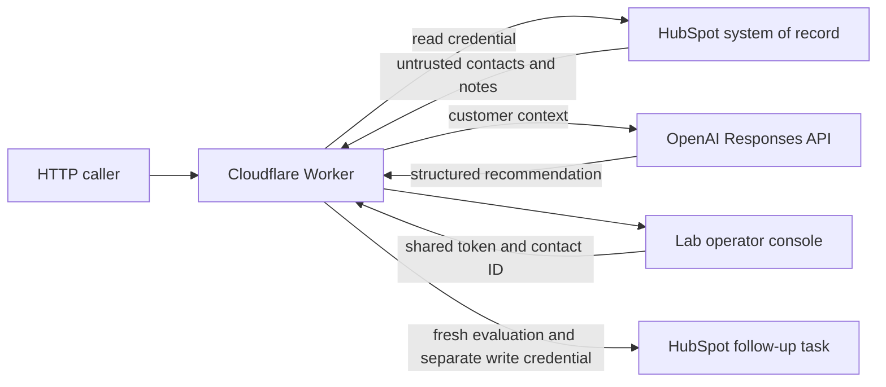

# Architecture, versions and trust boundaries

Status: source inspection based on `a2add93`, with tooling committed as `c256761`
and baseline collected at `5f88111`. Live model-only evaluation is recorded in
`baselines/README.md`. No deployed configuration or live HubSpot integration is
certified by this report. Main's `a056bcc` was merged into this branch; its only
change adds `keep_vars: true` to preserve dashboard variables on future deployments.
No deployment or production runtime-variable modification was performed here.

## Implemented behavior

One Worker handles health, contact/note diagnostics, deterministic/AI evaluation,
stress testing, previews and approved task creation. Read paths use
`HUBSPOT_ACCESS_TOKEN`; task creation uses `HUBSPOT_WRITE_TOKEN`. Notes are stripped
of HTML. Eligibility requires notes with at least 20 characters; AI history sorts
supplied timestamps lexicographically. The model receives customer name,
lifecycle/lead status and note text/timestamps. It returns one evaluation for the
whole contact history, not independent findings.

The prompt instructs evidence fidelity, actor attribution, chronology, injection
resistance and human review. Provider strict JSON schema constrains structure;
there is no independent semantic verification. Output is JSON-parsed without a
separate runtime schema check. The grader added here is an offline control.

Writes require the enable flag, shared approval token, explicit approval string,
credentials, eligible contact and fresh actionable evaluation. That fresh result
is not compared to the reviewed recommendation. The task payload is constructed
server-side and uses the separate write credential. The lab console is narrow;
no customer-management or general CRM functionality has been added.

## Trust boundaries

| Boundary | Current control | Gap |
| --- | --- | --- |
| Caller → Worker | Task POST restriction and shared token | No application auth for CRM/model endpoints; external access controls unverified |
| HubSpot → Worker | Read credential, bounded field list | Untrusted content; contact/association pagination and batch chunking absent |
| Worker → model | HTTPS, separate credential, structured request | Customer context crosses provider boundary; deployed PII/retention terms unverified |
| Model → Worker | Prompt and provider schema | Independent evidence, semantic and authority checks absent |
| Human → action | Shared token, explicit string, fresh evaluation | Finding/action binding, user identity, expiry and reapproval absent |
| Worker → task | Separate write credential; hard-coded task endpoint | No durable idempotency or ambiguous-outcome reconciliation |
| Runtime → operator/logs | No-store responses; observability enabled | Raw errors returned; no durable audit/retention/redaction contract |

Single-tenant isolation, external Viewer/Approver/Admin identity, 24-hour approval
validity and configurable 12-month minimal audit retention are approved future
controls, documented in `approved-hardening-policies.md`, not observed safeguards.
HubSpot retains customer history and task records.

## Version inventory

- Source release: `2026-11-02-revenue-opportunity-agent-v0.8`.
- Prompt/schema baseline labels: `reasoning-v0.1` / `evaluation-v0.1`.
  `fixtures/production-request-v0.1.json` captures pre-extraction instructions,
  schema, requested model and settings. A test compares the actual request to it.
- Default requested model: `gpt-5.6-terra`; reasoning effort `low`. Do not silently
  substitute a model if access or model availability fails.
- Legacy corpus `legacy-v1`: nine unchanged contexts and expected decisions.
- Expanded corpus `enterprise-v1`: 31 synthetic cases; grader `grader-v1`.
- Diagnostic rules: `deterministic diagnostic rules v0.2`, unchanged regex logic.
- Read API: `/crm/v3/objects`; write API: `/crm/objects/2026-09/tasks`, association
  type 204. Source observations do not prove compatibility or granted scopes.
- Worker compatibility date `2026-10-09`; package `0.1.0`; Wrangler range `^4.0.0`
  (installed `4.156.2`). No dependency lockfile in the original repository.

## Ranked risk register and test gaps

- **Critical if exposed with credentials:** unauthenticated CRM disclosure and
  caller-triggered model spending. External deployment protection is unverified.
- **High:** contact-bound replayable approvals; duplicate tasks and ambiguous
  outcomes; no operator-specific audit; singleton output loses independent
  findings; no independent runtime semantic/schema validation.
- **Medium:** first 100 contacts only, no association paging/batch chunking,
  silent missing-note omissions, timestamp assumptions, length-only eligibility,
  raw upstream errors, missing explicit request deadlines and rate-limit handling,
  unpinned dependency resolution and unverified environment isolation. Health says
  ready/read-only without checking upstream readiness or reflecting write enablement.
- **Low:** legacy operational descriptions and routing/reasoning/test coupling.

The corpus covers the plan's requested categories but often with only one case.
It is not a representative sample, held-out benchmark, authentication suite or
writeback certification. Remaining tests include credential scopes/tenant identity,
ingestion error and pagination cases, approval expiry/binding, concurrency,
reconciliation, audit retention, provider failures and deployed trust settings.
Those belong to later phases; no CRM expansion is needed to address them.
